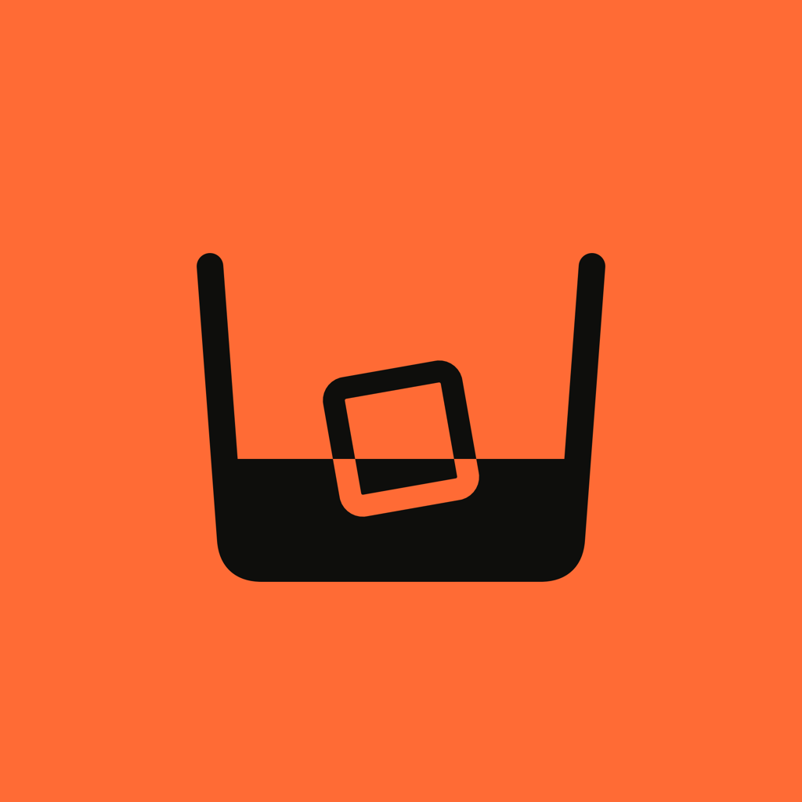
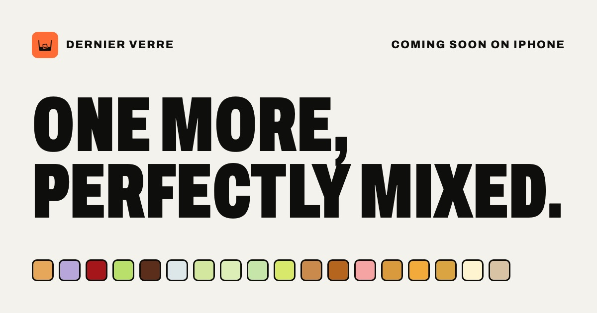

  

<h1 align="center">Dernier Verre</h1>

<strong>One more, perfectly mixed.</strong>

  52 cocktail recipes as full-screen posters. Tick what’s in your bar and see what you can mix tonight. No account needed.

  <a href="https://dernierverre.app">dernierverre.app</a> · <a href="https://dernierverre.app/fr/">Français</a> · <a href="https://dernierverre.app/cocktails/">All recipes</a>

## Made for the home bar

Dernier Verre is an iPhone app for making cocktails with what you already have. Every drink is a full-screen poster in its own colour, with big type you can read across the kitchen counter. Swipe for the next idea, tick the bottles in your cabinet, and pour with exact measures. No feed, no ads, and no sign-up.

## What you can do

- **Swipe through ideas.** One cocktail per screen, full-bleed in its own colour. The whole feed repaints itself as you go.
- **Start from a spirit.** Gin, vodka, rum, tequila, whisky, cognac and pisco, apéritifs, bubbles, liqueurs — or alcohol-free.
- **Tick your bar.** Check off what you have and see what’s ready to serve, and what you’re one ingredient away from.
- **Find the right drink.** Filter by occasion, flavour, strength and difficulty: an apéritif on the patio, something smoky for a cosy night.
- **Pour it right.** Exact measures in ml or oz, scaled from one glass to twelve, with numbered steps and the garnish.
- **Let chance pick.** Reached the end of the feed? Surprise me picks a drink. Not feeling it? One more idea.
- **Keep the keepers.** Heart your favourites and share a full recipe — ingredients, steps, garnish — with whoever’s pouring.
- **Pour for everyone.** Six alcohol-free drinks, from a virgin mojito to a cucumber-basil lemonade.

## 52 classics, zero filler

From the Negroni to the Caesar, the Last Word to the Maple old fashioned. Every recipe is also on the web, in English and French: [dernierverre.app/cocktails](https://dernierverre.app/cocktails/).

## Private by default

No account, no sign-up. Your bar and your favourites are stored on your iPhone and never leave it. All recipes are built in, so it works offline.

## Download

Coming soon to the App Store for iPhone — free.

---

## En français

**Un dernier, parfaitement dosé.**

Dernier Verre est une app iPhone pour préparer des cocktails avec ce que vous avez déjà. Chaque cocktail est une affiche plein écran dans sa propre couleur, sans compte et sans pub.

- **Faites défiler les idées** : un cocktail par écran, et tout le fil prend la couleur de chaque verre.
- **Cochez votre bar** : voyez ce qui est prêt à servir, et ce qui est à un ingrédient près.
- **Trouvez le bon verre** : filtrez par occasion, saveurs, intensité et difficulté.
- **Dosez juste** : doses exactes en ml ou en oz, de un à douze verres, avec les étapes et la garniture.
- **Laissez le hasard choisir**, gardez vos favoris et partagez la recette complète.
- **Pour tout le monde** : six boissons sans alcool, du virgin mojito à la limonade concombre-basilic.

Bientôt sur l’App Store pour iPhone, gratuitement. Toutes les recettes sont déjà sur [dernierverre.app/fr](https://dernierverre.app/fr/).

---

Made with ♥ by Wibeset in Canada

